<!-- Generated by scripts/generate.py. Edit the script, not the SVGs.. -->

<picture><source media="(prefers-color-scheme: dark)" srcset="assets/hero-dark.svg"><source media="(prefers-color-scheme: light)" srcset="assets/hero-light.svg">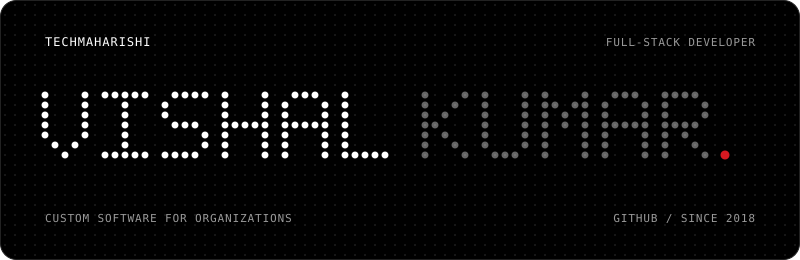</picture>

<picture><source media="(prefers-color-scheme: dark)" srcset="assets/about-dark.svg"><source media="(prefers-color-scheme: light)" srcset="assets/about-light.svg">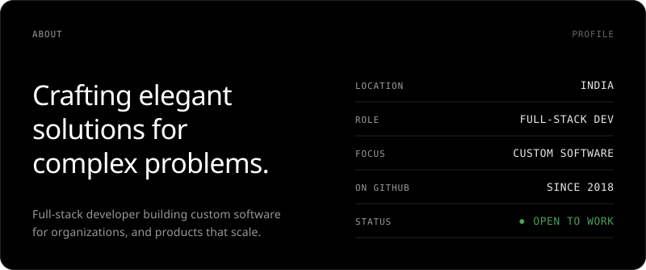</picture>

<picture><source media="(prefers-color-scheme: dark)" srcset="assets/stack-dark.svg"><source media="(prefers-color-scheme: light)" srcset="assets/stack-light.svg">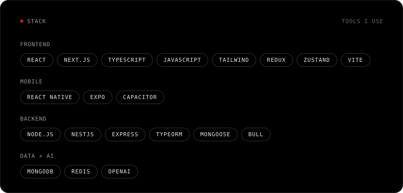</picture>

<picture><source media="(prefers-color-scheme: dark)" srcset="assets/work-header-dark.svg"><source media="(prefers-color-scheme: light)" srcset="assets/work-header-light.svg"></picture>

<a href="https://stack-tube-ai-gamma.vercel.app/"><picture><source media="(prefers-color-scheme: dark)" srcset="assets/card-01-dark.svg"><source media="(prefers-color-scheme: light)" srcset="assets/card-01-light.svg">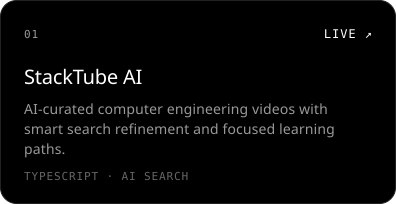</picture></a><a href="https://github.com/TechMaharishi/react_to_apk"><picture><source media="(prefers-color-scheme: dark)" srcset="assets/card-02-dark.svg"><source media="(prefers-color-scheme: light)" srcset="assets/card-02-light.svg">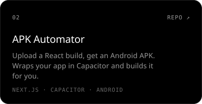</picture></a>

<a href="https://roadmap-psi-eight.vercel.app"><picture><source media="(prefers-color-scheme: dark)" srcset="assets/card-03-dark.svg"><source media="(prefers-color-scheme: light)" srcset="assets/card-03-light.svg">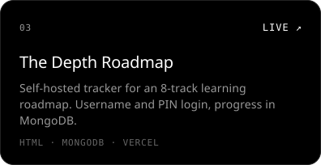</picture></a><a href="https://webworks-xi.vercel.app"><picture><source media="(prefers-color-scheme: dark)" srcset="assets/card-04-dark.svg"><source media="(prefers-color-scheme: light)" srcset="assets/card-04-light.svg">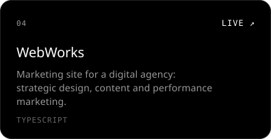</picture></a>

<a href="https://pycray-xi.vercel.app"><picture><source media="(prefers-color-scheme: dark)" srcset="assets/card-05-dark.svg"><source media="(prefers-color-scheme: light)" srcset="assets/card-05-light.svg">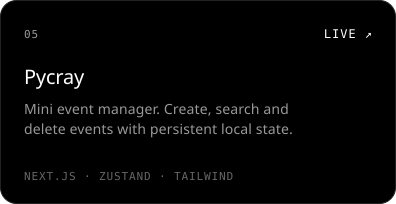</picture></a><a href="https://movix-eta-khaki.vercel.app"><picture><source media="(prefers-color-scheme: dark)" srcset="assets/card-06-dark.svg"><source media="(prefers-color-scheme: light)" srcset="assets/card-06-light.svg">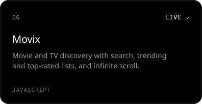</picture></a>

<picture><source media="(prefers-color-scheme: dark)" srcset="assets/activity-dark.svg"><source media="(prefers-color-scheme: light)" srcset="assets/activity-light.svg">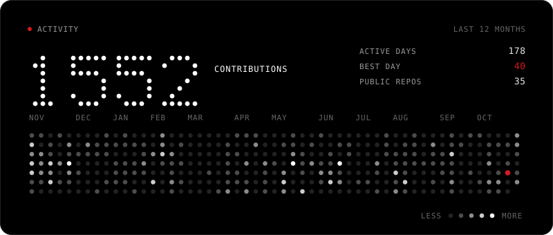</picture>

<picture><source media="(prefers-color-scheme: dark)" srcset="assets/footer-dark.svg"><source media="(prefers-color-scheme: light)" srcset="assets/footer-light.svg">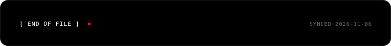</picture>

